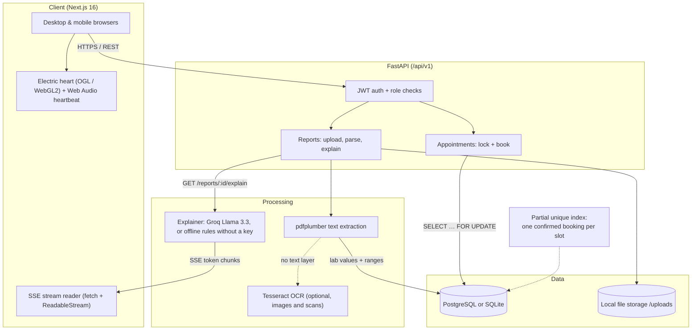

<div align="center">

<!-- Hero Animated Banner -->


<p align="center">
  <strong>An Apple-caliber AI health companion that translates opaque diagnostic lab reports and vitals into calm, plain-language insights with conflict-safe doctor scheduling.</strong>
</p>

<!-- Badges & Shields -->
<p align="center">
  <a href="https://github.com/CodeWidKrish/PulseOS/actions/workflows/ci.yml">
    
  </a>
  <a href="https://github.com/CodeWidKrish/PulseOS/blob/main/LICENSE">
    
  </a>
  <a href="https://nextjs.org/">
    
  </a>
  <a href="https://fastapi.tiangolo.com/">
    
  </a>
  <a href="https://www.postgresql.org/">
    
  </a>
  <a href="https://groq.com/">
    
  </a>
</p>

<p align="center">
  <a href="#-quick-start"><strong>🚀 Quick Start</strong></a> •
  <a href="#-core-architecture"><strong>📐 Architecture</strong></a> •
  <a href="#-key-features"><strong>✨ Features</strong></a> •
  <a href="docs/PROJECT_BRIEF.md"><strong>📖 Project Brief</strong></a> •
  <a href="docs/DESIGN_SYSTEM.md"><strong>🎨 Design Authority</strong></a> •
  <a href="docs/openapi.yaml"><strong>📜 API Contract</strong></a>
</p>

---

</div>

## 🫀 The Vision

Patients receive diagnostic laboratory reports full of impenetrable clinical jargon, confusing reference intervals, and abbreviations they cannot interpret. The result is anxiety, delayed follow-up care, unnecessary emergency visits, and poor longitudinal health tracking.

**PulseOS** fixes this by functioning as an intelligent, empathetic health companion. Upload a lab PDF or scan, and PulseOS translates every biomarker into conversational, 8th-grade language, highlights values outside standard reference ranges, generates targeted questions to bring to a physician, tracks vitals over 7-day and 30-day horizons, and reserves appointments with doctors using atomic, double-booking-proof transactions.

> 🛡️ **The Clinical Axiom**: PulseOS explains, organizes, and routes users to certified human care. It strictly **never diagnoses or prescribes treatment**.

---

## ⚡ The Translation: Before & After

```
┌─────────────────────────────────────────────────────────┬────────────────────────────────────────────────────────┐
│ 🔴 RAW CLINICAL REPORT                                  │ 🟢 PULSEOS PLAIN-LANGUAGE COMPANION                    │
├─────────────────────────────────────────────────────────┼────────────────────────────────────────────────────────┤
│ HBA1C (NGSP) : 5.8 %  [REF: 4.0 - 5.6]                  │ "Your HbA1c is 5.8%, which is slightly above typical   │
│ ESTIMATED AVG GLUCOSE : 120 mg/dL                       │ reference levels. This reflects your average blood     │
│ METHOD : HPLC                                           │ sugar over the last 3 months. It is not a diagnosis,   │
│ INTERPRETATION : IMPAIRED FASTING GLUCOSE               │ but a common signal to chat with your doctor about     │
│                                                         │ everyday nutrition and physical activity."             │
│                                                         │                                                        │
│                                                         │ 💡 Questions for your doctor:                          │
│                                                         │ • "Would you recommend re-checking this in 3 months?"  │
│                                                         │ • "Should I monitor fasting fingerstick glucose?"      │
└─────────────────────────────────────────────────────────┴────────────────────────────────────────────────────────┘
```

---

## 🛠️ Tech Stack & Systems

<div align="center">

<a href="https://skillicons.dev">
  
</a>

</div>

<br />

| Layer | Technologies | Key Architectural Purpose |
| :--- | :--- | :--- |
| **Frontend Web** | Next.js 16 (App Router), React 19, TypeScript, Tailwind CSS v4 | Marketing site plus authenticated patient and physician workspaces |
| **Motion & Graphics** | OGL (WebGL2 shader), GSAP ScrollTrigger, Lenis, Framer Motion, Recharts | Interactive electric heart, scroll story, calm UI motion, trend charts |
| **Audio** | Web Audio API | Heartbeat synthesized in the browser (split S1/S2 valve sounds), no audio files |
| **Backend API** | FastAPI (Python 3.11+), Pydantic v2, SQLAlchemy 2 (async) | REST endpoints, schema validation, Server-Sent Events streaming |
| **Database** | PostgreSQL (Docker) or SQLite (local demo) | Relational data, `SELECT … FOR UPDATE` booking locks, partial unique index |
| **AI Explainer** | Groq (`llama-3.3-70b-versatile`) or built-in offline rule-based explainer | Plain-language explanation streamed over SSE; offline mode needs no API key |
| **Document Parsing** | `pdfplumber` (+ optional Tesseract OCR for images and scans) | Extracts lab values with their reference ranges |
| **Security & Auth** | Argon2 password hashing, JWT (15-min access + 7-day refresh), role checks | Patients only ever see their own data; physician-only endpoints |

---

## 📐 Core Architecture



---

## ✨ Key Features

| Feature | Engineering Highlights | UX & Safety Guarantees |
| :--- | :--- | :--- |
| **🫀 Electric Heart Hero** | WebGL2 shader heart (OGL) with cursor interaction and a synthesized lub-dub heartbeat that starts on the visitor's first interaction. | Visible mute toggle (remembered). Honours `prefers-reduced-motion`. |
| **📜 Pinned Story Narrative** | GSAP ScrollTrigger story with Lenis smooth scrolling. | Falls back to stacked panels under reduced motion. |
| **🧪 Streaming Report Explainer** | PDF text extraction, line-by-line lab-value parsing, explanation streamed over Server-Sent Events; questions for the doctor saved with the report. | Never diagnoses or suggests medication. Urgent-care notice only for markedly abnormal values. Works offline with a rule-based explainer. |
| **📊 Vitals & Health Score** | Recharts trends with the normal range shaded, 7/30-day views, rule-based Health Score (0–100). | Tabular numerals, trend badges, input validation. |
| **📅 Conflict-Safe Appointments** | Row lock plus a partial unique index stops double booking; cancelled slots can be rebooked. Calendar (.ics) export. | Physicians see their own schedule in a dedicated view. |
| **🖨️ Doctor Visit Sheet** | Print-ready sheet of out-of-range values and questions from any explained report. | One click from the report page. |

---

## 🔒 Security & Privacy Model

Implemented today:

- **Minimal data to the model**: only test name, value, unit and reference range are sent to the LLM, never names or emails.
- **Ownership isolation**: every report, vital and appointment query is scoped to the signed-in user; physician endpoints require the doctor role.
- **Passwords and sessions**: Argon2 hashing; short-lived access tokens with refresh.
- **No real health data**: synthetic samples only, and report contents are never written to logs.
- **Double-booking immunity**: bookings run in a transaction with a row lock, backed by a partial unique index (one confirmed appointment per slot):
  ```sql
  SELECT * FROM availability_slots WHERE id = :slot_id FOR UPDATE;
  ```

Planned (see [`docs/NEXT_PHASE.md`](docs/NEXT_PHASE.md)): rate limiting on auth and uploads, file-type sniffing on upload, refusing the default secret key in production, and httpOnly cookie sessions.

---

## 🚀 Quick Start

### One-command local demo (Windows)

```powershell
# from the repo root, after installing Python 3.11+ and Node 20+
pip install -r api/requirements.txt
cd web; npm install; cd ..
copy .env.example api\.env     # then set DATABASE_URL=sqlite+aiosqlite:///./pulseos-demo.db
powershell -ExecutionPolicy Bypass -File scripts/start-demo.ps1
```

The script seeds synthetic data, starts the API on `:8100` and the website on `:3000`, and opens Chrome.
Sign in with **Patient demo** or **Physician demo**, then open **Lab reports → Try a sample report**.

<details>
<summary><b>🔧 Manual setup</b></summary>

```bash
# API
cd api
pip install -r requirements.txt
python -m app.core.seed                      # creates tables + synthetic demo data
uvicorn app.main:app --port 8100             # docs at http://localhost:8100/api/docs

# Web (new terminal)
cd web
npm install
NEXT_PUBLIC_API_URL=http://localhost:8100 npm run dev
```

</details>

---

## ⚙️ Environment Configuration

| Variable | Description | Service | Secret? |
| :--- | :--- | :--- | :---: |
| `DATABASE_URL` | `postgresql+asyncpg://…` or `sqlite+aiosqlite:///./pulseos-demo.db` | `api` | **Yes** |
| `SECRET_KEY` | Signs access and refresh tokens (`openssl rand -hex 32`) | `api` | **Yes** |
| `LLM_PROVIDER` | `groq` (falls back to offline without a key) or `offline` | `api` | No |
| `GROQ_API_KEY` | Optional Groq key for Llama 3.3 explanations | `api` | **Yes** |
| `CORS_ORIGINS` | Allowed web origins, JSON array or comma list | `api` | No |
| `UPLOAD_DIR` | Where uploaded reports are stored | `api` | No |
| `NEXT_PUBLIC_API_URL` | API base URL baked into the web build | `web` | No |

---

## 🗺️ Project Roadmap

- [x] **Specifications & design system** ([`DESIGN.md`](DESIGN.md), `docs/`)
- [x] **Marketing site**: electric heart hero, scroll story, interactive demo, synthesized heartbeat
- [x] **Auth & roles**: register, login, refresh, patient and physician views
- [x] **Report explainer**: PDF parsing, SSE streaming, offline and Groq providers, saved doctor questions
- [x] **Vitals**: logging, trend charts, rule-based health score
- [x] **Appointments**: conflict-safe booking, cancel and rebook, physician schedule, .ics export
- [x] **CI**: lint, type-check, tests and build on every push
- [ ] **Alembic migrations** (tables are currently created on startup)
- [ ] **Hardening**: rate limits, upload sniffing, production secret check
- [ ] **Playwright end-to-end suite & Lighthouse budgets**
- [ ] **Production deployment** (Vercel + Render/Railway)

---

## ⚖️ Clinical Disclaimer & Compliance Statement

> **IMPORTANT MEDICAL NOTICE**:  
> PulseOS is an educational and health companion portfolio demonstration project. It is **NOT** a medical diagnostic device, does **NOT** provide medical diagnoses or treatment plans, and is **NOT** HIPAA or DPDP certified. All clinical data presented in screenshots, demonstrations, and test suites consists entirely of synthetic or sample records. Always seek the advice of a qualified physician with any questions regarding medical conditions.

---

<div align="center">

<!-- Footer Animated Wave -->


<sub>Designed and engineered with care by <a href="https://github.com/CodeWidKrish">CodeWidKrish</a>. Licensed under the <a href="LICENSE">MIT License</a>.</sub>

</div>
