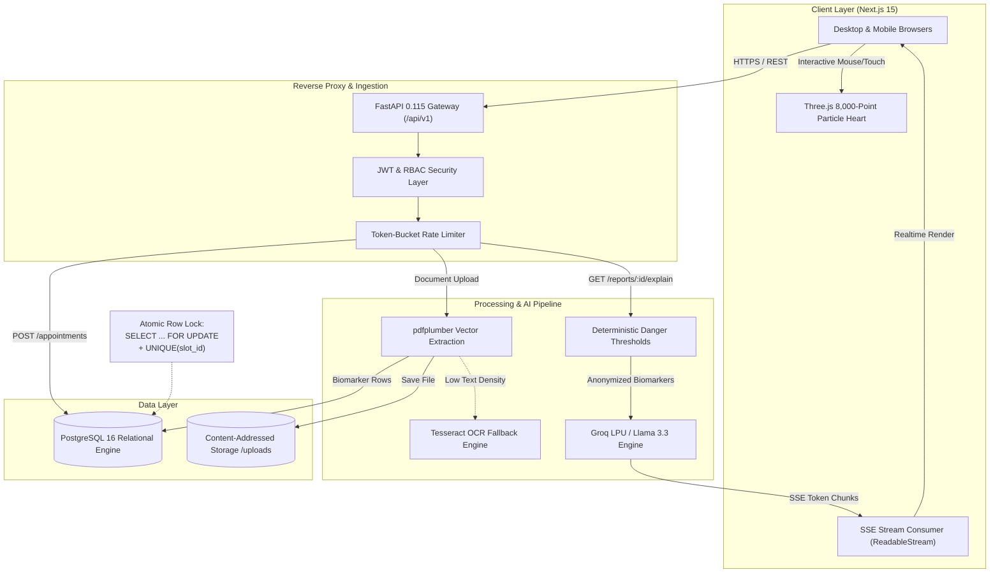

<div align="center">

<!-- Hero Animated Banner -->


<p align="center">
  <strong>An Apple-caliber AI health companion that translates opaque diagnostic lab reports and vitals into calm, plain-language insights with conflict-safe doctor scheduling.</strong>
</p>

<!-- Badges & Shields -->
<p align="center">
  <a href="https://github.com/CodeWidKrish/PulseOS/actions/workflows/ci.yml">
    
  </a>
  <a href="https://github.com/CodeWidKrish/PulseOS/blob/main/LICENSE">
    
  </a>
  <a href="https://nextjs.org/">
    
  </a>
  <a href="https://fastapi.tiangolo.com/">
    
  </a>
  <a href="https://www.postgresql.org/">
    
  </a>
  <a href="https://groq.com/">
    
  </a>
</p>

<p align="center">
  <a href="#-quick-start"><strong>🚀 Quick Start</strong></a> •
  <a href="#-core-architecture"><strong>📐 Architecture</strong></a> •
  <a href="#-key-features"><strong>✨ Features</strong></a> •
  <a href="docs/PROJECT_BRIEF.md"><strong>📖 Project Brief</strong></a> •
  <a href="docs/DESIGN_SYSTEM.md"><strong>🎨 Design Authority</strong></a> •
  <a href="docs/openapi.yaml"><strong>📜 API Contract</strong></a>
</p>

---

</div>

## 🫀 The Vision

Patients receive diagnostic laboratory reports full of impenetrable clinical jargon, confusing reference intervals, and abbreviations they cannot interpret. The result is anxiety, delayed follow-up care, unnecessary emergency visits, and poor longitudinal health tracking.

**PulseOS** fixes this by functioning as an intelligent, empathetic health companion. Upload a lab PDF or scan, and PulseOS translates every biomarker into conversational, 8th-grade language, highlights values outside standard reference ranges, generates targeted questions to bring to a physician, tracks vitals over 7-day and 30-day horizons, and reserves appointments with doctors using atomic, double-booking-proof transactions.

> 🛡️ **The Clinical Axiom**: PulseOS explains, organizes, and routes users to certified human care. It strictly **never diagnoses or prescribes treatment**.

---

## ⚡ The Translation: Before & After

```
┌─────────────────────────────────────────────────────────┬────────────────────────────────────────────────────────┐
│ 🔴 RAW CLINICAL REPORT                                  │ 🟢 PULSEOS PLAIN-LANGUAGE COMPANION                    │
├─────────────────────────────────────────────────────────┼────────────────────────────────────────────────────────┤
│ HBA1C (NGSP) : 5.8 %  [REF: 4.0 - 5.6]                  │ "Your HbA1c is 5.8%, which is slightly above typical   │
│ ESTIMATED AVG GLUCOSE : 120 mg/dL                       │ reference levels. This reflects your average blood     │
│ METHOD : HPLC                                           │ sugar over the last 3 months. It is not a diagnosis,   │
│ INTERPRETATION : IMPAIRED FASTING GLUCOSE               │ but a common signal to chat with your doctor about     │
│                                                         │ everyday nutrition and physical activity."             │
│                                                         │                                                        │
│                                                         │ 💡 Questions for your doctor:                          │
│                                                         │ • "Would you recommend re-checking this in 3 months?"  │
│                                                         │ • "Should I monitor fasting fingerstick glucose?"      │
└─────────────────────────────────────────────────────────┴────────────────────────────────────────────────────────┘
```

---

## 🛠️ Tech Stack & Systems

<div align="center">

<a href="https://skillicons.dev">
  
</a>

</div>

<br />

| Layer | Technologies | Key Architectural Purpose |
| :--- | :--- | :--- |
| **Frontend Web** | Next.js 15 (App Router), TypeScript, Tailwind CSS | High-performance responsive SPA, server-rendered landing, client state |
| **3D & Motion** | Three.js / R3F, Custom GLSL Shaders, GSAP, Lenis | 8,000-particle interactive heart, cursor repulsion physics, 60fps scroll |
| **Backend API** | FastAPI (Python 3.11+), Pydantic v2, SQLAlchemy 2 | Asynchronous REST endpoints, strict schema validation, SSE generator |
| **Database** | PostgreSQL 16 + asyncpg + Alembic | ACID relational engine, `SELECT FOR UPDATE` row locks, temporal queries |
| **AI Inference** | Groq Cloud LPU (`llama-3.3-70b-versatile`) | Ultra-fast token generation streamed over Server-Sent Events (SSE) |
| **Document OCR** | `pdfplumber` + `pytesseract` | Multi-engine PDF vector text and scanned raster optical extraction |
| **Security & Auth** | Argon2id, JWT (Access 15m + Refresh 7d HttpOnly) | Stateless auth with cookie rotation, magic-byte upload sniffers, RBAC |

---

## 📐 Core Architecture



---

## ✨ Key Features

| Feature | Engineering Highlights | UX & Safety Guarantees |
| :--- | :--- | :--- |
| **🫀 3D Particle Heart Hero** | Custom GLSL vertex & fragment shaders controlling ~8,000 points. Real-time cursor repulsion using smoothstep distance vectors. | Steady 60 FPS, caps DPR at 2.0. Graceful SVG radial gradient fallback when WebGL is unsupported. |
| **📜 Pinned Story Narrative** | GSAP ScrollTrigger timeline pinned across 300vh. The 3D heart travels, rotates 360°, and shifts across Pulse, Teal, and Amber states. | Lenis smooth scrolling. Fully adheres to `prefers-reduced-motion: reduce`. |
| **🧪 Streaming AI Explainer** | Document ingestion via `pdfplumber` with automatic fallback to `pytesseract`. Structured tokens streamed over Server-Sent Events. | 8th-grade readability tier. Deterministic pre-flight check flags critical thresholds before LLM is invoked. |
| **📊 Longitudinal Vitals** | Time-series Recharts with 7-day and 30-day horizon toggles. Composite **Health Score (0–100)** computed with documented rules. | Monospaced tabular numerals, trend direction indicators, and physiological sanity validations. |
| **📅 Conflict-Safe Appointments** | Doctor directory and weekly calendar slots. Guarantees zero double-booking via database row locks and unique constraints. | Instant optimistic toast confirmation, slot status updates, and automated confirmation dispatch. |
| **🛡️ Zero-Compromise Security** | Passwords hashed with Argon2id. Short-lived 15m access tokens + rotating 7-day HttpOnly refresh cookies. Magic-byte file validation. | Complete ownership isolation: users can only view their own diagnostic records. Never logs health data. |

---

## 🔒 Security & Privacy Model

PulseOS was engineered from Day 1 under a strict healthtech threat model:

- **Strict Anonymization**: No patient names, MRNs, dates of birth, or email addresses are ever transmitted to the LLM. Only structured numeric biomarker pairs (`test_name`, `value`, `unit`, `ref_range`) enter the model context.
- **Deterministic Danger Alerting**: Severe physiological values (e.g., Potassium > 6.2 mmol/L, Platelets < 20,000 /mcL) trigger a hardcoded emergency clinical escalation banner *before* AI inference.
- **Prompt Injection Defense**: Raw text strings extracted from PDFs are decoupled from instruction prompts; input is validated strictly against structured JSON schemas.
- **Double-Booking Immunity**: Appointment reservations execute within an atomic transaction:
  ```sql
  SELECT * FROM availability_slots 
  WHERE id = :slot_id AND is_booked = FALSE 
  FOR UPDATE;
  ```

---

## 🚀 Quick Start

Get the entire stack (Next.js web app, FastAPI API, and PostgreSQL database) running locally in **5 commands**:

```bash
# 1. Clone the repository
git clone https://github.com/CodeWidKrish/PulseOS.git
cd PulseOS

# 2. Configure environment variables
cp .env.example .env

# 3. Spin up services in Docker Compose
docker compose up --build -d

# 4. Apply database migrations
docker compose exec api alembic upgrade head

# 5. Open in your browser
# Web App  -> http://localhost:3000
# API Docs -> http://localhost:8000/docs
```

<details>
<summary><b>🔧 Manual Local Development (Without Docker)</b></summary>

### Backend Setup (FastAPI)
```bash
cd api
python -m venv venv
source venv/bin/activate  # On Windows: .\venv\Scripts\activate
pip install -r requirements.txt
alembic upgrade head
uvicorn app.main:app --reload --port 8000
```

### Frontend Setup (Next.js)
```bash
cd web
npm install
npm run dev
# Running on http://localhost:3000
```

</details>

---

## ⚙️ Environment Configuration

| Variable | Description | Required Service | Secret? |
| :--- | :--- | :--- | :---: |
| `NEXT_PUBLIC_API_URL` | Base endpoint URL for the FastAPI backend | `web` | No |
| `DATABASE_URL` | Async PostgreSQL connection URI (`postgresql+asyncpg://...`) | `api` | **Yes** |
| `JWT_SECRET_KEY` | 256-bit cryptographic key for Access Tokens | `api` | **Yes** |
| `REFRESH_SECRET_KEY` | 256-bit cryptographic key for Refresh Tokens | `api` | **Yes** |
| `GROQ_API_KEY` | Groq Cloud API key for ultra-fast LPU inference | `api` | **Yes** |
| `CORS_ORIGINS` | Permitted web origins (`https://pulseos.health,http://localhost:3000`) | `api` | No |
| `UPLOAD_DIR` | Mount path for uploaded report files | `api` | No |

---

## 🗺️ Project Roadmap

- [x] **Monorepo Architecture & Specifications** (11 comprehensive pre-implementation docs)
- [x] **Canonical Design System** ([`DESIGN.md`](DESIGN.md) featuring Apple-inspired aesthetics)
- [x] **Relational Schema & Migrations** (Users, Reports, Biomarkers, Vitals, Doctors, Appointments)
- [x] **Interactive 3D Particle Prototype** ([`reference/pulseos-final.html`](reference/pulseos-final.html))
- [ ] **Milestone 1**: 3D Particle Canvas & Pinned Scroll Narrative Port into Next.js
- [ ] **Milestone 2**: Server-Sent Events (SSE) AI Streaming Explainer Integration
- [ ] **Milestone 3**: Longitudinal Vitals Charts & Deterministic Health Scoring
- [ ] **Milestone 4**: Conflict-Safe Doctor Directory & Appointment Booking
- [ ] **Milestone 5**: Playwright End-to-End Test Suite & Lighthouse 90+ Verification
- [ ] **Milestone 6**: Production Deployment (Vercel + Render/Railway)

---

## ⚖️ Clinical Disclaimer & Compliance Statement

> **IMPORTANT MEDICAL NOTICE**:  
> PulseOS is an educational and health companion portfolio demonstration project. It is **NOT** a medical diagnostic device, does **NOT** provide medical diagnoses or treatment plans, and is **NOT** HIPAA or DPDP certified. All clinical data presented in screenshots, demonstrations, and test suites consists entirely of synthetic or sample records. Always seek the advice of a qualified physician with any questions regarding medical conditions.

---

<div align="center">

<!-- Footer Animated Wave -->


<sub>Designed and engineered with care by <a href="https://github.com/CodeWidKrish">CodeWidKrish</a>. Licensed under the <a href="LICENSE">MIT License</a>.</sub>

</div>
