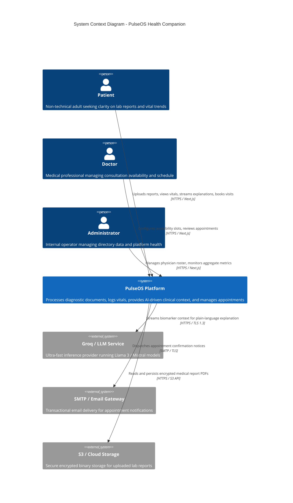
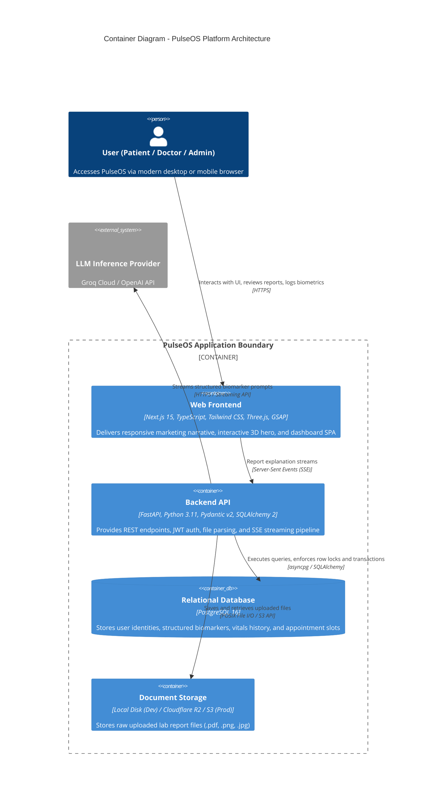
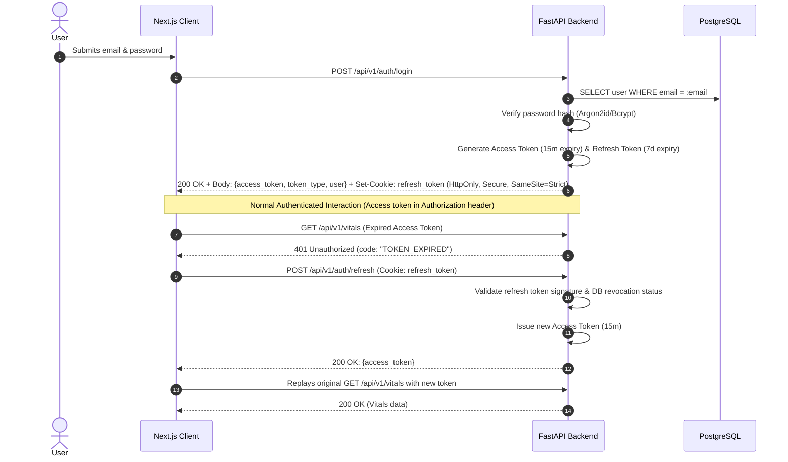

# PulseOS — Architecture & Architecture Decision Records (ADRs)

## 1. System Overview & Context

PulseOS is an intelligent, high-performance personal health companion platform. It accepts medical diagnostic documents, extracts and structures biometric values, produces plain-language streaming AI explanations, provides longitudinal vitals tracking, and supports transactional doctor appointment bookings.

### 1.1 System Context Diagram (C4 Level 1)


---

## 2. Container Diagram (C4 Level 2)



---

## 3. Core Request & Data Flows

### 3.1 Report Explainer: Upload to Streamed Explanation
```mermaid
sequenceDiagram
    autonumber
    actor Patient as Patient (Browser)
    participant Web as Next.js Web App
    participant API as FastAPI Backend
    participant Parser as Report Parser (pdfplumber / OCR)
    participant Rules as Deterministic Rule Engine
    participant LLM as Groq / LLM Service
    participant DB as PostgreSQL 16

    Patient->>Web: Selects/drops PDF/image file (≤10MB)
    Web->>API: POST /api/v1/reports (Multipart form data + Bearer JWT)
    API->>API: Validate file size, magic bytes, sanitize filename
    API->>DB: INSERT into reports (user_id, filename, status='processing')
    API->>Parser: Extract text (pdfplumber; fallback Tesseract)
    Parser-->>API: Extracted raw text & tabular bounding boxes
    API->>Parser: Parse biomarkers (test_name, value, unit, ref_range)
    Parser-->>API: Structured biomarker records
    API->>DB: INSERT into report_values (report_id, biomarkers...)
    API-->>Web: 201 Created (report metadata, parsed biomarker list)

    Patient->>Web: Clicks "Explain My Report"
    Web->>API: GET /api/v1/reports/{id}/explain (SSE request)
    API->>DB: Fetch report and report_values
    API->>Rules: Check for critical physiological thresholds (e.g., Potassium > 6.2)
    alt Critical Value Detected
        Rules-->>API: Urgent escalation flag + pre-scripted emergency notice
    end
    API->>LLM: Stream structured prompt (anonymized biomarker table + system instructions)
    loop Token Generation
        LLM-->>API: Stream token chunks
        API-->>Web: SSE Event: event: chunk, data: {"text": "..."}
        Web-->>Patient: Render streamed response with aria-live="polite"
    end
    API->>DB: INSERT into report_explanations (summary, details, questions)
    API-->>Web: SSE Event: event: done, data: {"explanation_id": "..."}
```

### 3.2 Authentication & Token Refresh Flow


---

## 4. Frontend-to-Backend Communication Contract

1. **HTTP Client Architecture**:
   - Centralized Axios instance (`lib/api.ts`) configured with `baseURL: process.env.NEXT_PUBLIC_API_URL || 'http://localhost:8000/api/v1'`.
   - **Request Interceptor**: Automatically attaches `Authorization: Bearer <access_token>` from memory/session state.
   - **Response Interceptor**: Intercepts `401 Unauthorized` responses with code `TOKEN_EXPIRED`, buffers concurrent requests, triggers `/auth/refresh`, updates the active token, and replays pending calls.
2. **Streaming Consumer Architecture**:
   - Server-Sent Events are consumed using the native browser `fetch` API with `ReadableStream` reader (or `EventSourcePolyfill`) to support sending custom `Authorization` Bearer headers.
   - Incoming SSE event types: `open`, `chunk`, `warning` (urgent value detected), `error`, and `done`.
3. **Error Handling Protocol**:
   - Shared unified API error format across all endpoints:
     ```json
     {
       "error": {
         "code": "SLOT_ALREADY_BOOKED",
         "message": "The selected appointment slot has already been reserved.",
         "details": []
       }
     }
     ```

---

## 5. Storage & Asynchronous Processing Strategy

### 5.1 File Storage Strategy
- **Development / Local**: Uploaded reports are stored in a dedicated local directory (`/uploads`) mapped via Docker volume mounts. Files are renamed using content-addressed hashes (`sha256(content).pdf`) to eliminate collisions and path traversal attacks.
- **Production**: An abstract storage driver (`services/storage.py`) switches seamlessly to an S3-compatible object store (Cloudflare R2 or AWS S3) via boto3 with AES-256 server-side encryption.

### 5.2 Synchronous vs. Asynchronous Work
- **Synchronous Execution**: PDF text parsing via `pdfplumber` (typically <200ms for standard 1–3 page clinical reports), regex biomarker structuring, vitals logging, and appointment reservation transactions are performed synchronously in the HTTP request lifecycle.
- **Asynchronous Execution**: 
  - Image OCR (`pytesseract`) triggers async thread pool execution if text density is below threshold to avoid blocking the event loop.
  - LLM text generation is streamed asynchronously token-by-token over SSE using Python's `asyncio` and `StreamingResponse`.

---

## 6. Environment Separation & Configuration

| Setting | Local Development | Continuous Integration (CI) | Production |
| :--- | :--- | :--- | :--- |
| **Frontend Runtime** | `localhost:3000` (Node dev server) | Next.js Build Validation | Vercel Edge / CDN |
| **Backend Runtime** | `localhost:8000` (Uvicorn reload) | Pytest ephemeral runner | Render / Railway (Dockerized) |
| **Database** | PostgreSQL in Docker Compose | Ephemeral Postgres service | Managed PostgreSQL (Neon/Supabase/Railway) |
| **Storage Driver** | Local Disk (`./uploads`) | Ephemeral tmp directory | S3 / Cloudflare R2 |
| **AI Provider** | Groq Cloud API / Mock LLM service | Mock AI Service (fixed deterministic output) | Groq Cloud API (`llama-3.3-70b-versatile`) |
| **Mailer** | Local Console Logger | Mock Mailer | Production SMTP / Transactional API |

---

## 7. Architecture Decision Records (ADRs)

### ADR-001: Technology Stack — Next.js (App Router) & FastAPI
- **Status**: Accepted
- **Context**: PulseOS requires a rich, marketing-grade frontend with modern 3D graphics and smooth motion, coupled with a high-performance backend capable of PDF parsing, OCR, and AI streaming.
- **Decision**: Adopt Next.js 15 (App Router, TypeScript) for the frontend and FastAPI (Python 3.11, Pydantic v2) for the backend.
- **Alternatives Considered**: 
  - *Full-stack Next.js (Node.js API routes)*: Lacks mature, high-performance medical document parsing and OCR libraries (e.g., `pdfplumber`, `pytesseract`).
  - *Django + Django REST Framework*: Excessively heavyweight with monolithic boilerplate; slower async streaming capabilities than FastAPI.
- **Consequences**: Enables clean separation of concerns; leverages best-in-class Python health data processing while maintaining an elite React frontend.

### ADR-002: Monorepo Repository Structure
- **Status**: Accepted
- **Context**: The project is maintained as a cohesive full-stack portfolio codebase requiring unified CI/CD and atomic documentation.
- **Decision**: Implement a unified monorepo with `web/`, `api/`, `docs/`, and `reference/` folders orchestrated via Docker Compose.
- **Alternatives Considered**: Polyrepo (separate git repos for frontend and backend). Polyrepo adds synchronization overhead, fragmented versioning, and complex PR tracking.
- **Consequences**: Simplified local development with single-command Docker startup; shared API specifications and coordinated release tracking.

### ADR-003: JWT Access + Refresh Tokens vs. Stateful Server Sessions
- **Status**: Accepted
- **Context**: PulseOS requires secure authentication with role-based authorization across distributed cloud hosting (Vercel frontend and Render/Railway backend).
- **Decision**: Implement dual-token JWT authentication: short-lived Access Tokens (15 minutes) sent via `Authorization: Bearer` headers and long-lived Refresh Tokens (7 days) stored in `HttpOnly`, `SameSite=Strict` cookies.
- **Alternatives Considered**: Server-side session store with Redis. Requires maintaining an additional stateful Redis cluster, increasing operational cost and complexity for MVP.
- **Consequences**: Stateless horizontally scalable backend; requires client-side Axios token interceptor for silent token refreshing.

### ADR-004: Server-Sent Events (SSE) vs. WebSockets for AI Explainer Streaming
- **Status**: Accepted
- **Context**: The AI report explainer generates conversational text that must stream to the patient's screen in real time as tokens arrive from the LLM.
- **Decision**: Utilize Server-Sent Events (SSE) via HTTP `text/event-stream`.
- **Alternatives Considered**: WebSockets. WebSockets introduce bidirectional complexity, connection keepalive management, and proxy/load-balancer configuration issues not required for unidirectional server-to-client streaming.
- **Consequences**: Native HTTP/2 multiplexing support; built-in browser reconnection mechanisms; lightweight and standard REST routing.

### ADR-005: File Storage Strategy — Local Volume Mount (Dev) to S3-Compatible Object Storage (Prod)
- **Status**: Accepted
- **Context**: Lab reports uploaded by patients must be safely persisted, retrieved for explanation, and never checked into source control.
- **Decision**: Define a unified `StorageService` interface with local filesystem implementation for local development and an S3-compatible driver (Cloudflare R2 / AWS S3) for production.
- **Alternatives Considered**: Storing raw PDF binary data as `BYTEA` inside PostgreSQL. Bloats database size, degrades backup/restore performance, and strains connection bandwidth.
- **Consequences**: Keeps database lean and fast; requires content-hashed filenames and proper bucket permissions in production.

### ADR-006: AI Provider Abstraction Interface (`ai_service`)
- **Status**: Accepted
- **Context**: PulseOS requires LLM inference (specifically Groq for high-speed streaming), but must avoid hard-coupling to a single vendor to maintain flexibility and test reproducibility.
- **Decision**: Encapsulate all generative AI calls behind an abstract `AIService` interface with swappable adapters (`GroqAIService`, `OpenAIAIService`, and `MockAIService`).
- **Alternatives Considered**: Direct SDK calls embedded inside route handlers. Severely hampers automated unit testing and blocks instant provider switching during upstream outages.
- **Consequences**: Unit tests run deterministically using `MockAIService` with zero API costs; production seamlessly uses Groq with fallback capabilities.

---

## 8. Open Questions
1. Should the S3/R2 storage driver generate pre-signed temporary URLs for direct file download, or should the FastAPI backend proxy file downloads through ownership verification?
2. In production, should we implement an in-memory token revocation blocklist in the API or maintain a `revoked_tokens` table in PostgreSQL?
