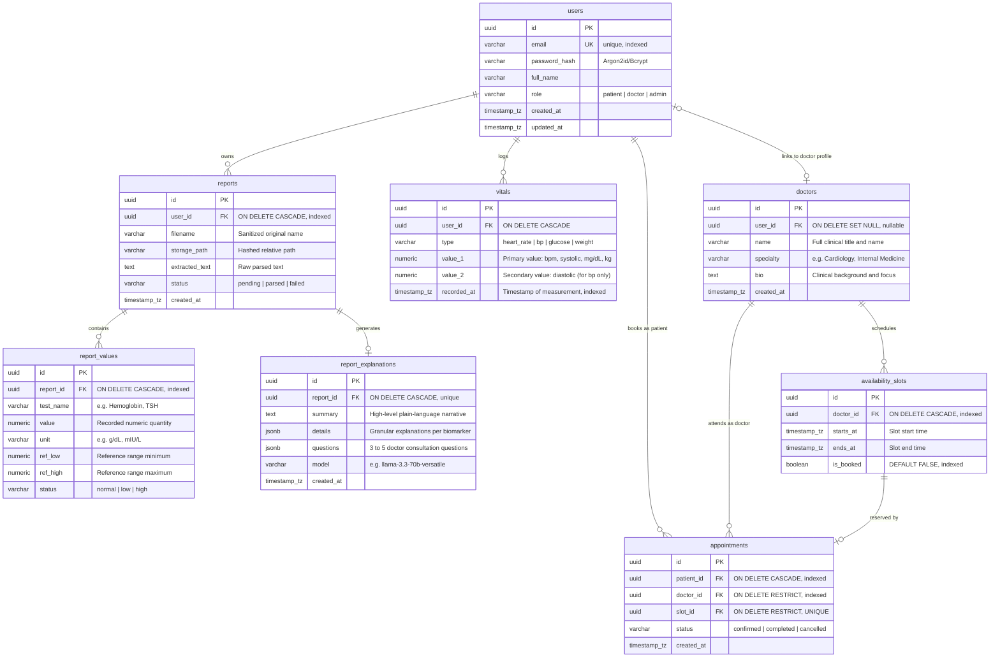

# PulseOS — Data Model & Schema Specification

## 1. Entity-Relationship Diagram (ERD)



---

## 2. Relational Schema Definitions

### 2.1 Table: `users`
Represents all system users with role-based permissions.
```sql
CREATE TABLE users (
    id UUID PRIMARY KEY DEFAULT gen_random_uuid(),
    email VARCHAR(255) NOT NULL,
    password_hash VARCHAR(255) NOT NULL,
    full_name VARCHAR(150) NOT NULL,
    role VARCHAR(20) NOT NULL DEFAULT 'patient',
    created_at TIMESTAMP WITH TIME ZONE NOT NULL DEFAULT NOW(),
    updated_at TIMESTAMP WITH TIME ZONE NOT NULL DEFAULT NOW(),
    CONSTRAINT uq_users_email UNIQUE (email),
    CONSTRAINT ck_users_role CHECK (role IN ('patient', 'doctor', 'admin'))
);

CREATE INDEX idx_users_email ON users(email);
```

### 2.2 Table: `reports`
Diagnostic laboratory reports uploaded by patients.
```sql
CREATE TABLE reports (
    id UUID PRIMARY KEY DEFAULT gen_random_uuid(),
    user_id UUID NOT NULL,
    filename VARCHAR(255) NOT NULL,
    storage_path VARCHAR(500) NOT NULL,
    extracted_text TEXT,
    status VARCHAR(30) NOT NULL DEFAULT 'pending',
    created_at TIMESTAMP WITH TIME ZONE NOT NULL DEFAULT NOW(),
    CONSTRAINT fk_reports_user FOREIGN KEY (user_id) REFERENCES users(id) ON DELETE CASCADE,
    CONSTRAINT ck_reports_status CHECK (status IN ('pending', 'parsed', 'failed'))
);

CREATE INDEX idx_reports_user_id ON reports(user_id);
CREATE INDEX idx_reports_created_at ON reports(created_at DESC);
```

### 2.3 Table: `report_values`
Granular structured biomarkers parsed from diagnostic documents.
```sql
CREATE TABLE report_values (
    id UUID PRIMARY KEY DEFAULT gen_random_uuid(),
    report_id UUID NOT NULL,
    test_name VARCHAR(150) NOT NULL,
    value NUMERIC(10, 3) NOT NULL,
    unit VARCHAR(50) NOT NULL,
    ref_low NUMERIC(10, 3),
    ref_high NUMERIC(10, 3),
    status VARCHAR(20) NOT NULL,
    CONSTRAINT fk_report_values_report FOREIGN KEY (report_id) REFERENCES reports(id) ON DELETE CASCADE,
    CONSTRAINT ck_report_values_status CHECK (status IN ('normal', 'low', 'high'))
);

CREATE INDEX idx_report_values_report_id ON report_values(report_id);
```

### 2.4 Table: `report_explanations`
AI-generated plain-language interpretations and doctor discussion prompts.
```sql
CREATE TABLE report_explanations (
    id UUID PRIMARY KEY DEFAULT gen_random_uuid(),
    report_id UUID NOT NULL,
    summary TEXT NOT NULL,
    details JSONB NOT NULL DEFAULT '[]'::jsonb,
    questions JSONB NOT NULL DEFAULT '[]'::jsonb,
    model VARCHAR(100) NOT NULL,
    created_at TIMESTAMP WITH TIME ZONE NOT NULL DEFAULT NOW(),
    CONSTRAINT uq_report_explanations_report UNIQUE (report_id),
    CONSTRAINT fk_report_explanations_report FOREIGN KEY (report_id) REFERENCES reports(id) ON DELETE CASCADE
);

CREATE INDEX idx_report_explanations_report_id ON report_explanations(report_id);
```

### 2.5 Table: `vitals`
Longitudinal biometric measurements logged by users.
```sql
CREATE TABLE vitals (
    id UUID PRIMARY KEY DEFAULT gen_random_uuid(),
    user_id UUID NOT NULL,
    type VARCHAR(30) NOT NULL,
    value_1 NUMERIC(8, 2) NOT NULL,
    value_2 NUMERIC(8, 2),
    recorded_at TIMESTAMP WITH TIME ZONE NOT NULL DEFAULT NOW(),
    CONSTRAINT fk_vitals_user FOREIGN KEY (user_id) REFERENCES users(id) ON DELETE CASCADE,
    CONSTRAINT ck_vitals_type CHECK (type IN ('heart_rate', 'bp', 'glucose', 'weight'))
);

CREATE INDEX idx_vitals_user_recorded ON vitals(user_id, recorded_at DESC);
CREATE INDEX idx_vitals_user_type_recorded ON vitals(user_id, type, recorded_at DESC);
```

### 2.6 Table: `doctors`
Clinical practitioner profiles visible to patients for scheduling.
```sql
CREATE TABLE doctors (
    id UUID PRIMARY KEY DEFAULT gen_random_uuid(),
    user_id UUID,
    name VARCHAR(150) NOT NULL,
    specialty VARCHAR(100) NOT NULL,
    bio TEXT NOT NULL,
    created_at TIMESTAMP WITH TIME ZONE NOT NULL DEFAULT NOW(),
    CONSTRAINT fk_doctors_user FOREIGN KEY (user_id) REFERENCES users(id) ON DELETE SET NULL
);

CREATE INDEX idx_doctors_specialty ON doctors(specialty);
```

### 2.7 Table: `availability_slots`
Distinct calendar time slots offered by doctors.
```sql
CREATE TABLE availability_slots (
    id UUID PRIMARY KEY DEFAULT gen_random_uuid(),
    doctor_id UUID NOT NULL,
    starts_at TIMESTAMP WITH TIME ZONE NOT NULL,
    ends_at TIMESTAMP WITH TIME ZONE NOT NULL,
    is_booked BOOLEAN NOT NULL DEFAULT FALSE,
    CONSTRAINT fk_slots_doctor FOREIGN KEY (doctor_id) REFERENCES doctors(id) ON DELETE CASCADE,
    CONSTRAINT ck_slots_chronology CHECK (starts_at < ends_at)
);

CREATE INDEX idx_slots_doctor_starts ON availability_slots(doctor_id, starts_at);
CREATE INDEX idx_slots_available ON availability_slots(doctor_id, is_booked, starts_at);
```

### 2.8 Table: `appointments`
Scheduled appointments linking patients, doctors, and specific slots.
```sql
CREATE TABLE appointments (
    id UUID PRIMARY KEY DEFAULT gen_random_uuid(),
    patient_id UUID NOT NULL,
    doctor_id UUID NOT NULL,
    slot_id UUID NOT NULL,
    status VARCHAR(30) NOT NULL DEFAULT 'confirmed',
    created_at TIMESTAMP WITH TIME ZONE NOT NULL DEFAULT NOW(),
    CONSTRAINT uq_appointments_slot UNIQUE (slot_id),
    CONSTRAINT fk_appointments_patient FOREIGN KEY (patient_id) REFERENCES users(id) ON DELETE CASCADE,
    CONSTRAINT fk_appointments_doctor FOREIGN KEY (doctor_id) REFERENCES doctors(id) ON DELETE RESTRICT,
    CONSTRAINT fk_appointments_slot FOREIGN KEY (slot_id) REFERENCES availability_slots(id) ON DELETE RESTRICT,
    CONSTRAINT ck_appointments_status CHECK (status IN ('confirmed', 'completed', 'cancelled'))
);

CREATE INDEX idx_appointments_patient ON appointments(patient_id, created_at DESC);
CREATE INDEX idx_appointments_doctor ON appointments(doctor_id, created_at DESC);
```

---

## 3. Double-Booking Prevention Mechanism (Step-by-Step)

To guarantee that no consultation slot is double-booked even under intense concurrent load, PulseOS uses a **defense-in-depth approach** combining an atomic row lock with an immutable unique database constraint.

### Step 1: Database Hard Constraint
The `appointments` table enforces `CONSTRAINT uq_appointments_slot UNIQUE (slot_id)`. At the database engine level (B-Tree index), no two rows can ever reference the same `slot_id`.

### Step 2: Atomic Transactional Execution in FastAPI
```python
# Atomic booking service implementation
async with db_session.begin():
    # 1. Acquire row-level lock on the target slot
    slot = await db_session.execute(
        select(AvailabilitySlot)
        .where(
            AvailabilitySlot.id == slot_id,
            AvailabilitySlot.is_booked == False
        )
        .with_for_update()  # <-- SELECT ... FOR UPDATE
    ).scalar_one_or_none()

    # 2. Verify slot is still open
    if not slot:
        raise HTTPException(
            status_code=409, 
            detail="This slot is no longer available."
        )

    # 3. Mark slot as booked within the lock
    slot.is_booked = True

    # 4. Insert appointment record
    appointment = Appointment(
        patient_id=current_user.id,
        doctor_id=slot.doctor_id,
        slot_id=slot.id,
        status="confirmed"
    )
    db_session.add(appointment)
    # Commit automatically releases lock and confirms unique constraint
```

### Step 3: Concurrency Walkthrough
1. **User A and User B** simultaneously click "Book Slot #42" at $T_0$.
2. **Transaction A** enters the session and executes `SELECT ... WHERE id = 42 FOR UPDATE`. Postgres grants an exclusive row lock on Slot #42 to Transaction A.
3. **Transaction B** attempts `SELECT ... FOR UPDATE` on Slot #42. Postgres blocks Transaction B until Transaction A finishes.
4. **Transaction A** updates `is_booked = TRUE`, inserts the appointment, and commits at $T_1$.
5. **Transaction B** unblocks and evaluates Slot #42. Because `is_booked` is now `TRUE`, the `WHERE is_booked == False` condition evaluates to empty (`None`).
6. **FastAPI catches the empty slot** and returns an immediate HTTP `409 Conflict` to User B: `"This slot is no longer available."`
7. If any anomalous bypass occurred, the PostgreSQL unique index would abort Transaction B with a constraint violation error.

---

## 4. Vitals Storage & Longitudinal Querying Strategy

### 4.1 Storage Model
Vitals utilize a typed single-table layout:
- `heart_rate`: `value_1` stores beats per minute (bpm). `value_2` is `NULL`.
- `bp` (Blood Pressure): `value_1` stores Systolic (mmHg); `value_2` stores Diastolic (mmHg).
- `glucose`: `value_1` stores blood glucose (mg/dL). `value_2` is `NULL`.
- `weight`: `value_1` stores body weight (kg). `value_2` is `NULL`.

### 4.2 Querying for 7-Day & 30-Day Charts
FastAPI issues time-windowed queries leveraging the composite index `idx_vitals_user_type_recorded`:
```sql
-- Fetch recent readings for a specific vital type
SELECT id, type, value_1, value_2, recorded_at
FROM vitals
WHERE user_id = :user_id 
  AND type = :vital_type
  AND recorded_at >= NOW() - INTERVAL '30 days'
ORDER BY recorded_at ASC;
```

### 4.3 Aggregation & Health Score Calculation
1. **Trend & Averages**: The API aggregates daily averages using Python Pandas / NumPy or SQL window functions:
   $$\text{Daily Avg} = \frac{\sum \text{value\_1}}{N}$$
2. **Deterministic Health Score (0–100)**:
   A documented rule evaluates recent (last 7 days) readings against standard clinical reference guidelines:
   - **Blood Pressure**: Normal (<120 systolic and <80 diastolic) = 35/35 pts; Elevated (120–129 / <80) = 28/35 pts; Stage 1 (130–139 or 80–89) = 20/35 pts; Stage 2 (≥140 or ≥90) = 10/35 pts.
   - **Resting Heart Rate**: Normal (60–90 bpm) = 25/25 pts; Borderline (50–59 or 91–100) = 18/25 pts; Outlier (<50 or >100) = 8/25 pts.
   - **Fasting Glucose**: Normal (70–99 mg/dL) = 25/25 pts; Impaired (100–125 mg/dL) = 16/25 pts; High (≥126 mg/dL) = 8/25 pts.
   - **Engagement / Tracking Regularity**: At least 3 vitals logged in past 7 days = 15/15 pts; 1–2 logged = 8/15 pts; 0 logged = 0/15 pts.
   - **Total Health Score** = Sum of component scores (0 to 100).

---

## 5. Account Deletion & Data Retention Policy

When a user requests account deletion (`DELETE /api/v1/auth/me`):
1. **User Record & Relational Data**:
   - `DELETE FROM users WHERE id = :user_id` cascades immediately via `ON DELETE CASCADE`:
     - All `reports` and associated `report_values` and `report_explanations` are removed.
     - All `vitals` historical measurements are deleted.
     - All patient `appointments` are removed.
2. **Associated Slot Cleanup**:
   - Before deleting the appointment, an event hook resets `availability_slots.is_booked = FALSE` for any upcoming slots so that physicians' calendars are liberated.
3. **Physical File Unlinking**:
   - A post-deletion background task retrieves all storage paths associated with the user's reports and securely deletes the physical files from the local `/uploads` directory or S3/R2 bucket.

---

## 6. Seed Data Plan (100% Synthetic)

All seed and test data is strictly synthetic with fictitious names, dates, and diagnostic values:

1. **Users**:
   - Patient: `elena.rostova@sample.pulseos.health` (Password: `PulseOS2026!`, Role: `patient`)
   - Doctor: `dr.marcus.vance@sample.pulseos.health` (Role: `doctor`)
   - Admin: `admin@sample.pulseos.health` (Role: `admin`)
2. **Doctors**:
   - Dr. Marcus Vance, MD (Cardiology & Preventative Health)
   - Dr. Ayesha Patel, DO (Endocrinology & Metabolic Health)
3. **Diagnostic Reports**:
   - Synthetic CBC Report (`cbc_sample_normal.pdf`): Hemoglobin 14.2 g/dL, WBC 6,500 /mcL, Platelets 250,000 /mcL.
   - Synthetic Comprehensive Metabolic Panel (`cmp_sample_abnormal.pdf`): Glucose 118 mg/dL (High), Potassium 4.1 mmol/L (Normal), ALT 48 U/L (High).
4. **Vitals**:
   - 30-day realistic trajectory of daily Blood Pressure (118/76 to 124/82) and Resting Heart Rate (68 to 74 bpm).
5. **Slots & Appointments**:
   - 10 weekly availability slots for Dr. Vance, 2 marked as booked for demonstration.

---

## 7. Migration Sequence

Migrations are executed via Alembic in strict dependency order:
1. `001_create_users`: Table `users` with email uniqueness and role enum check.
2. `002_create_reports`: Table `reports` referencing `users(id)` with `ON DELETE CASCADE`.
3. `003_create_report_values`: Table `report_values` referencing `reports(id)` with `ON DELETE CASCADE`.
4. `004_create_report_explanations`: Table `report_explanations` with unique `report_id` constraint.
5. `005_create_vitals`: Table `vitals` with composite indexes on `(user_id, recorded_at)`.
6. `006_create_doctors`: Table `doctors` with optional `user_id` foreign key.
7. `007_create_availability_slots`: Table `availability_slots` referencing `doctors(id)`.
8. `008_create_appointments`: Table `appointments` with unique `slot_id` constraint.

---

## 8. Mapping Tables to User Stories

| Table | Relevant User Stories | Purpose in Feature |
| :--- | :--- | :--- |
| `users` | US-004, US-005, US-010 | Authentication, credential security, role authorization |
| `reports` | US-006, US-007, US-013 | File upload tracking, raw text storage, processing status |
| `report_values` | US-006, US-007 | Structured biomarkers with units and reference ranges |
| `report_explanations` | US-003, US-007 | Plain-language AI explanations, questions for doctors |
| `vitals` | US-008, US-009 | Longitudinal biometric tracking and 7d/30d chart rendering |
| `doctors` | US-010, US-011 | Provider directory, medical specialties, profile bios |
| `availability_slots` | US-010, US-011 | Slot scheduling, calendar exploration, booking availability |
| `appointments` | US-011 | Confirmed consultations, double-booking prevention |

---

## 9. Open Questions
1. Should `vitals` support customizable user-defined vital types in the future (e.g., Sleep Duration, SpO2) via a dynamic attribute schema?
2. Should cancelled appointments remain in the database with status `cancelled` indefinitely for auditing, or be purged after a 90-day retention window?
